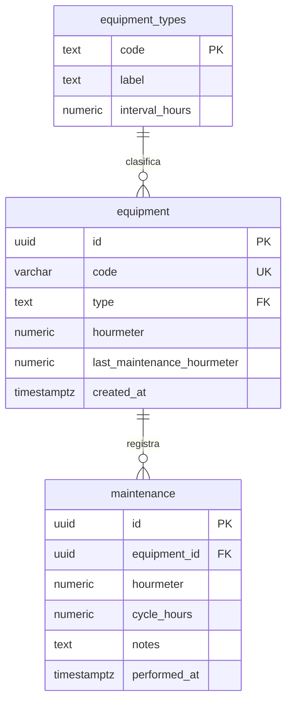

# MineTrack · Registro de equipos mineros

Aplicación pequeña para crear, listar, editar y eliminar equipos mineros; controlar mantenimiento por horómetro; registrar intervenciones y consultar su historial. Frontend y backend son servicios separados. PostgreSQL conserva los datos entre despliegues.

## Enlaces de entrega

- Repositorio público: https://github.com/takizawa30/headhunting4miners_RETO
- Frontend: https://minetrack-web.onrender.com
- Backend: https://minetrack-api-h9ld.onrender.com
- Salud de API y PostgreSQL: https://minetrack-api-h9ld.onrender.com/health
- El video de demostración se entrega como archivo en la plataforma de evaluación.

## Stack y estructura

- `frontend/`: JavaScript, CSS y Vite. Interfaz responsive en español, filtros por código, tipo y estado, CRUD e historial.
- `backend/`: Node.js 22+, Express 5, Zod, `pg` y migraciones SQL versionadas.
- `scripts/deploy.mjs`: despliegue desde terminal usando la API oficial de Render.
- `tests/`: reglas de negocio, fallos del despliegue e integración con PostgreSQL real.
- `render.yaml`: infraestructura reproducible (web estática, API y PostgreSQL).
- `compose.yaml` y `backend/Dockerfile`: entorno local con Docker.
- `.github/workflows/ci.yml`: pruebas y construcción en GitHub Actions, con PostgreSQL 17.

## Reglas de negocio

| Tipo | Intervalo |
| --- | ---: |
| Camión | 250 h |
| Excavadora | 500 h |
| Perforadora | 200 h |

Los intervalos son una decisión del ejercicio, no una recomendación del fabricante. Se guardan en `equipment_types`. Los códigos son únicos, se normalizan a mayúsculas y permiten letras, números, `-` y `_`. El horómetro acepta un decimal, desde 0 hasta 9 999 999 h, y no puede disminuir.

`horas_del_ciclo = horómetro_total - horómetro_del_último_mantenimiento`. Un equipo **requiere mantenimiento** cuando `horas_del_ciclo >= intervalo`. Al crear un equipo, el primer ciclo parte de 0 h. Si ya se hizo mantenimiento, se puede registrar inmediatamente después de crearlo.

Registrar mantenimiento inserta su fecha, notas, horómetro y horas del ciclo en el historial, y actualiza la referencia del siguiente ciclo. **No pone a cero el horómetro total.** Se permite mantenimiento preventivo antes del límite si hubo horas de uso. Sin nuevas horas se rechaza un nuevo mantenimiento. Una transacción y `SELECT … FOR UPDATE` impiden que dos solicitudes simultáneas cierren el mismo ciclo dos veces. Cambiar el tipo aplica su nuevo intervalo al ciclo actual. Eliminar un equipo elimina también su historial, con confirmación en la interfaz.

### Modelo de datos



`schema_migrations` registra nombre, checksum y fecha de cada migración. Se ejecutan en una transacción con bloqueo asesor para evitar carreras. Repetirlas no cambia datos ni duplica tablas. Una migración ya aplicada no se edita: se agrega otra. Las migraciones futuras deben ser compatibles con la versión anterior mientras conviven los dos servicios.

## Ejecutar en local

Requisitos: Node.js 22 o superior, npm y Git. Para datos persistentes, PostgreSQL 17 o Docker.

```sh
npm ci
```

### Opción rápida sin instalar PostgreSQL ni Docker

```sh
# Terminal 1: PostgreSQL temporal real + API
npm run dev:local
# Terminal 2: frontend
npm run dev:web
```

Abre http://localhost:5173. API: http://localhost:3000/health. Esta opción usa binarios de PostgreSQL distribuidos mediante `embedded-postgres` y datos temporales; al detenerse se borran. No instala servicios del sistema. Los puertos 3000, 5173 y 55438 deben estar libres.

### Opción persistente

```sh
# PowerShell: Copy-Item .env.example .env
cp .env.example .env
docker compose up -d db
npm run migrate
npm run dev:api
# En otra terminal
npm run dev:web
```

La URL predeterminada de `.env.example` coincide con Docker. Para otro PostgreSQL cambia `DATABASE_URL`. Alternativamente, `docker compose up --build -d` inicia PostgreSQL y API; levanta el frontend con `npm run dev:web`.

Vite lee las variables de `.env` en la raíz. Los cambios en sus variables requieren reiniciar el frontend. Usa únicamente datos ficticios: esta demo del reto no incorpora usuarios ni autenticación; quien acceda a la API pública puede modificar los registros.

## API REST

| Método | Ruta | Resultado |
| --- | --- | --- |
| GET | `/health` | 200 si consulta PostgreSQL y el esquema; 503 si falla. Incluye revisión del backend. |
| GET | `/api/types` | Tipos e intervalos |
| GET | `/api/equipment` | Equipos con estado calculado |
| POST | `/api/equipment` | Crea equipo (201) |
| PUT | `/api/equipment/:id` | Edita código, tipo y horómetro |
| DELETE | `/api/equipment/:id` | Elimina equipo e historial (204) |
| GET | `/api/equipment/:id/maintenance` | Historial, más reciente primero |
| POST | `/api/equipment/:id/maintenance` | Registra mantenimiento y reinicia ciclo (201) |

```json
{ "code": "CAM-001", "type": "camion", "hourmeter": 250 }
```

```json
{ "notes": "Cambio de aceite y revisión de filtros" }
```

Errores: 400 datos inválidos, 404 inexistente, 409 código duplicado, horómetro decreciente o mantenimiento sin nuevas horas. Las consultas usan parámetros; no se envían errores SQL ni credenciales al cliente. CORS permite el frontend configurado, pero no sustituye la autenticación.

## Preparar Render una sola vez

1. Crea una cuenta de Render y conecta el repositorio público. No incluyas claves en GitHub.
2. Puedes importar `render.yaml` en **New > Blueprint**, o crear estos recursos manualmente:
   - PostgreSQL 17, plan **Free**, región Oregon.
   - Web Service Node, plan **Free**, rama `main`, raíz del repositorio. Build: `npm ci --omit=dev && npm run build -w backend`. Start: `npm start -w backend`. Health check: `/health`.
   - Static Site, rama `main`, raíz del repositorio. Build: `npm ci && npm run build -w frontend`. Publish directory: `frontend/dist`.
3. Configura backend: `NODE_VERSION=22.22.0`, `NODE_ENV=production`, `DATABASE_URL` interna de Render, `FRONTEND_URL` con la URL HTTPS exacta del sitio estático (sin `/` final).
4. Configura frontend: `NODE_VERSION=22.22.0`, `VITE_API_URL` con la URL HTTPS exacta del backend. El Blueprint enlaza esta última automáticamente.
5. Desactiva **Auto-Deploy** en ambos servicios. El comando controla el orden y fija el commit de ambos. La creación inicial puede iniciar su primer build antes de completar las variables; vuelve a desplegar cuando estén listas.
6. Crea una API key en tu cuenta de Render y guárdala únicamente en `.env`. Copia los IDs `srv-…` de los dos servicios y sus URLs en ese archivo. Para `DATABASE_URL` local usa la conexión **externa** de la base de Render; no la interna. Usa `?sslmode=require` para TLS remoto. La regla de acceso de PostgreSQL debe permitir tu IP para las migraciones desde tu PC.

Variables requeridas por `npm run deploy`:

```dotenv
RENDER_API_KEY=...
RENDER_BACKEND_SERVICE_ID=srv-...
RENDER_FRONTEND_SERVICE_ID=srv-...
DATABASE_URL=postgresql://.../minetrack?sslmode=require
BACKEND_URL=https://TU-API.onrender.com
FRONTEND_PUBLIC_URL=https://TU-WEB.onrender.com
```

La creación de cuenta, autorización de GitHub, creación inicial de infraestructura y configuración de secretos son preparación única. Los despliegues siguientes se hacen con **un solo comando**, desde la raíz:

```sh
npm run deploy
```

Antes de ejecutarlo sube tus cambios:

```sh
git add .
git commit -m "Describe el cambio"
git push
npm run deploy
```

### Qué hace el comando

1. Comprueba Node, Git, variables, URLs HTTPS distintas, IDs, árbol Git limpio y que el commit local coincide con la rama remota. Valida vía API que los servicios son del tipo, repositorio, rama y URL esperados, con Auto-Deploy desactivado. Bloquea dos ejecuciones locales simultáneas.
2. Instala con `npm ci`, ejecuta pruebas y construye frontend y backend localmente.
3. Aplica migraciones SQL sobre PostgreSQL remoto. Falla antes de publicar si no hay conexión o una migración falla.
4. Pide a Render construir y publicar **el SHA exacto** del backend. Espera estado `live` y falla ante build fallido, cancelación o timeout.
5. Construye y publica ese mismo SHA del frontend; espera `live`.
6. Verifica frontend HTTP, `/version.json`, `/health`, consulta real de equipos y CORS. Comprueba que frontend y backend exponen el mismo SHA solicitado. Reintenta durante el despertar y propagación de la versión.

Un fallo detiene la secuencia, imprime `ERROR [etapa]` y termina con código distinto de 0. No imprime secretos. El timeout de cada deploy es 20 minutos por defecto (`DEPLOY_TIMEOUT_SECONDS`, entre 10 y 3600). El proceso se puede repetir: las migraciones no se duplican y cada despliegue construye el commit solicitado. Si se interrumpe a la fuerza, revisa Render y elimina `.deploy.lock` antes de volver a intentar. No ejecutes despliegues simultáneos desde distintas máquinas.

La API ejecuta también las migraciones al iniciar, una protección útil para el primer despliegue. El comando de terminal las ejecuta explícitamente antes de publicar.

### Fallos y recuperación

- Variable faltante: completa `.env` a partir de `.env.example`.
- Git sucio o commit distinto: confirma los cambios y haz `git push`.
- HTTP 401/403 de Render: revisa tu API key y workspace.
- Migración fallida: verifica conexión externa, TLS y acceso de red. No edites una migración aplicada.
- Build fallido: abre los logs del servicio. No se inicia el frontend si falla el backend.
- Timeout: el despliegue podría seguir en Render. Comprueba su estado antes de reintentar.
- Health/CORS/revisión: comprueba las variables del servicio y vuelve a desplegar.

No hay rollback automático. Render conserva despliegues anteriores para recuperación manual; si el frontend falla tras publicar el backend, este puede quedar en la versión nueva. Las migraciones tampoco se revierten automáticamente para evitar pérdida de datos. Este límite es deliberado y el comando informa error.

### Límites del plan gratuito

Render duerme la API tras 15 minutos sin tráfico; el primer acceso puede tardar aproximadamente un minuto. PostgreSQL Free expira a los **30 días**. Revisa la fecha en el panel y conserva una exportación si necesitas los datos. Para una demo permanente, cambia la base a un plan que no expire. Consulta los límites vigentes en https://render.com/docs/free. No contrates recursos de pago si no los necesitas para esta evaluación.

## Validación

```sh
npm test                  # reglas y despliegue; integración si hay TEST_DATABASE_URL
npm run test:postgres     # PostgreSQL real temporal, sin Docker
npm run build
```

Para una base de pruebas propia, define `TEST_DATABASE_URL` y ejecuta `npm test`. Usa una base dedicada, nunca la de producción. La integración crea códigos únicos y elimina sus propios registros. Verifica migraciones repetidas, alta, duplicados, edición, horómetro decreciente, mantenimiento, historial, concurrencia y borrado en cascada. GitHub Actions ejecuta estas pruebas con PostgreSQL real.

## Herramientas de apoyo

Se utilizó OpenAI Codex como apoyo en el desarrollo, las pruebas, la documentación y la configuración del despliegue.

## Docker

El repositorio incluye `backend/Dockerfile` y `compose.yaml` para ejecutar la API y PostgreSQL localmente. **El despliegue público usa el runtime Node de Render, no contenedores Docker.** La configuración de Docker está incluida como alternativa; no se ha validado ejecutándola en esta máquina, que no tiene Docker instalado.
